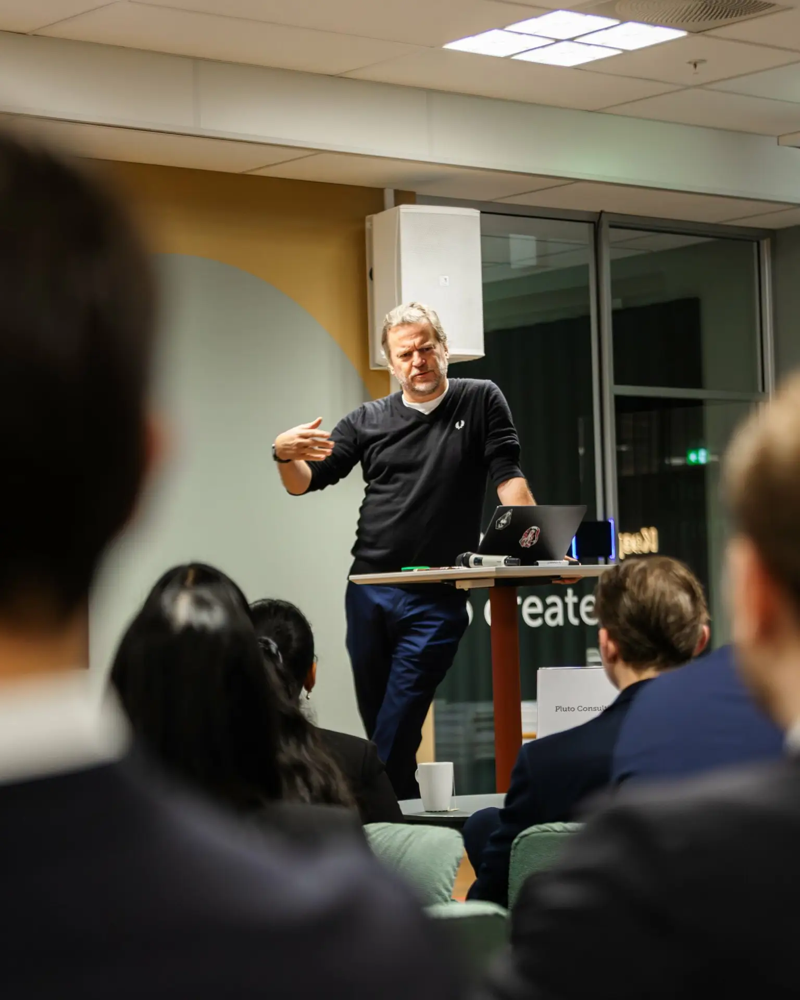
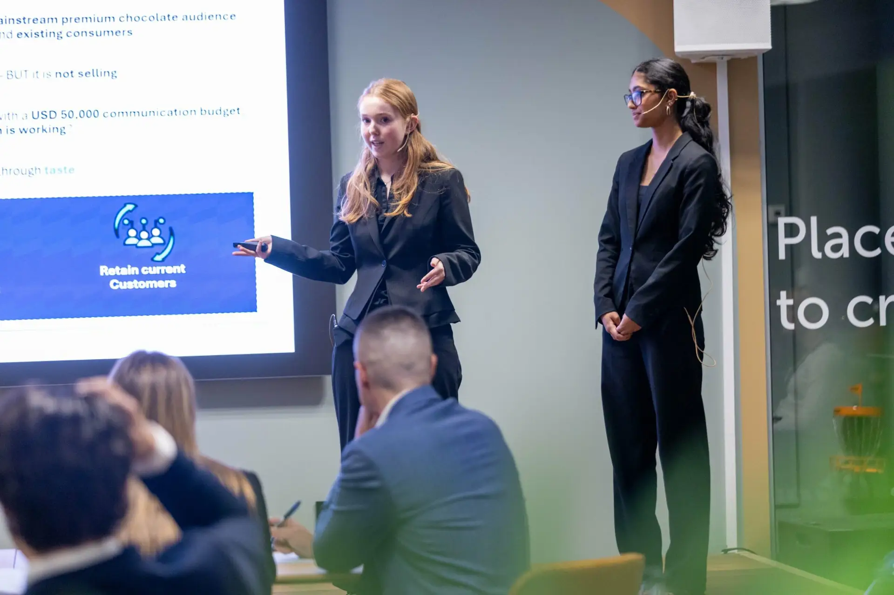
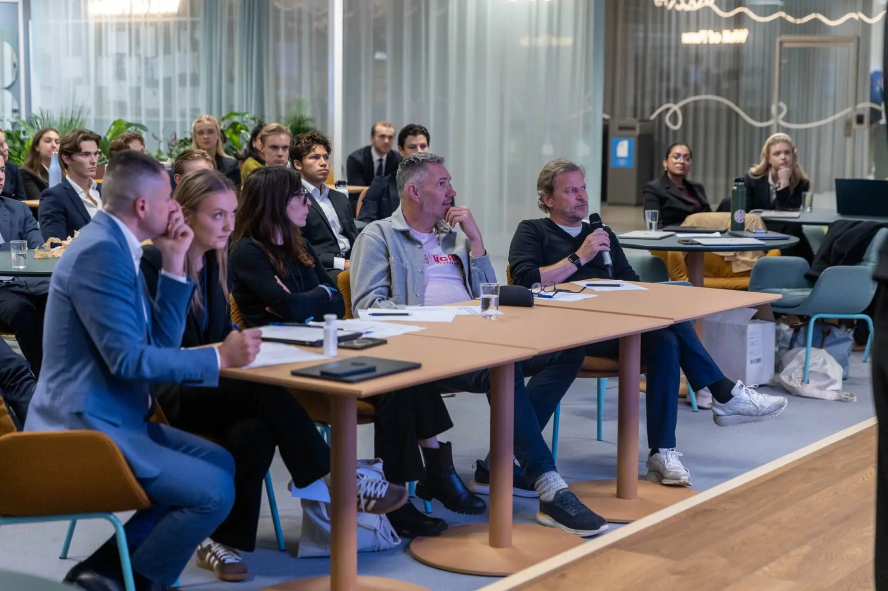

Letzten Dienstag haben Thomas Kraft und ich einen Nachmittag an der BI Norwegian Business School in Oslo verbracht. Nicht, um einen Vortrag zu halten. Sondern um einem Raum voller Studenten das Problem in die Hand zu drücken, an dem wir bei VGAN Chocolate gerade wirklich arbeiten.

## Das Problem

VGAN macht milchfreie Schokolade, die die meisten nicht vom Original unterscheiden können. 44 % Kakao, Hafermilchbasis, bio-zertifiziert. Wo sie in den USA im Regal liegt, verkauft sie sich besser als die Kategorie. Der Haken ist das Regal selbst. „Plant-based“ vorne auf der Packung sagt dem Käufer eine Sache, bevor er überhaupt probiert hat: Das schmeckt schlechter.

Also ziehen wir um. Neuer Name, neue Identität, neues Regal. Premium-Schokolade statt Better-for-you. US-Einführung 2027. Die Schokolade selbst bleibt, wie sie ist.

Das war der Case: Wie bringt man eine Marke unter neuem Namen in die USA, behält die Kunden und Händler, die man schon hat – und macht das mit dem Budget eines kleinen Start-ups aus Norwegen. Sprich: nicht viel.

Der neue Name blieb vertraulich. Die Studenten haben mit einem Platzhalter gearbeitet. Einige haben sich ernsthaft Mühe gegeben, ihn zu erraten. Keiner hat es geschafft.

*Foto: BI Norwegian Business School*

## Womit ich nicht gerechnet habe

Wir hatten viel Zeit, über das Ganze nachzudenken. Thomas hat schon Firmen aufgebaut. Ich mache seit rund 30 Jahren Marketing, Werbung und Paid Social. Die Lösung ist für uns klar.

Die Studenten hatten eine Woche, um die Firma zu recherchieren, und vier Stunden, um als Team an der Aufgabe zu arbeiten, nachdem wir sie übergeben hatten. Das sind Management- und Business-Studenten. Keine Marketing-Studenten.

Das Gewinnerteam hat nicht mit einer neuen Idee gewonnen. Es hat gewonnen, weil es fast Schritt für Schritt das präsentiert hat, was wir vorhaben. Mit einer Woche Recherche und vier Stunden Arbeit. Das ist entweder leicht demütigend oder sehr beruhigend. Ich habe mich für beruhigend entschieden.

*Foto: BI Norwegian Business School*

Und ja, wir hätten gern etwas komplett Neues gesehen – und wir haben von mehreren Teams Ideen und Anregungen mitgenommen, die wir weiterentwickeln können. Genau darum ging es.

## Die Jury

Fünf Juroren: drei Professoren der BI, Thomas als Gründer und CEO und ich als Head of Marketing. Es war knapp. Die Gewinner haben es mit hauchdünnem Vorsprung geholt, die Teams dahinter lagen nicht weit zurück. Das sagt einiges über die Qualität der Leute, die die BI als Berater und Manager in die Welt schickt – und über die Professoren, die sie ausbilden.

*Foto: BI Norwegian Business School*

Danke an die BI Norwegian Business School, das Team hinter der BI National Case Competition und jeden Studenten, der eine Woche und einen Nachmittag damit verbracht hat, über milchfreie Schokolade nachzudenken. Ihr wisst, wer ihr seid. Einige von euch werden von uns hören.

Der Name wird 2027 öffentlich. Ich sag Bescheid, sobald ich darf.

*Chris Helmbrecht ist Marketing Director bei VGAN Chocolate und führt Die Neue, eine Beratung für Marketing und KI in München.*
