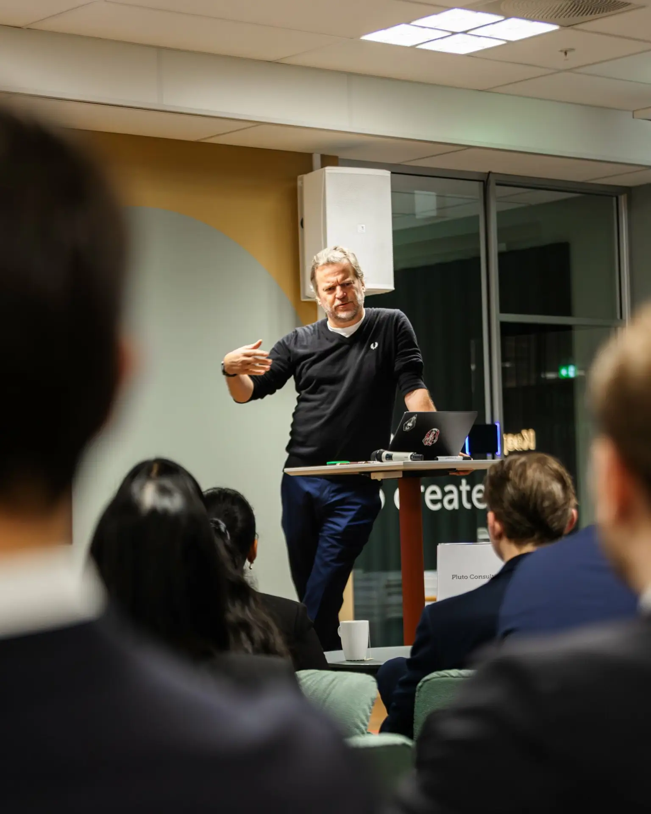
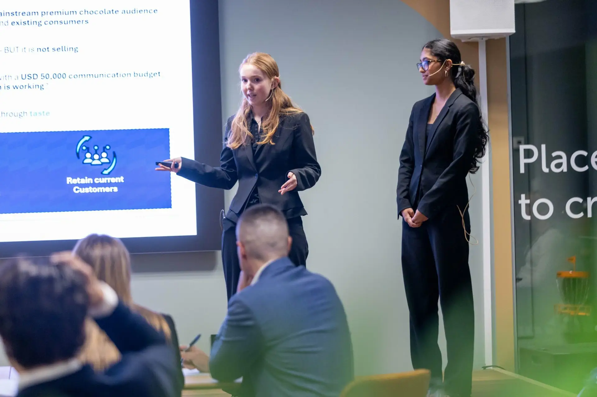
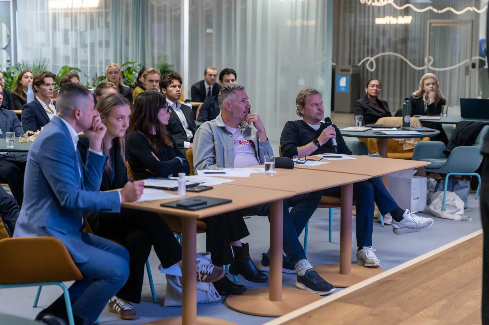

Last Tuesday Thomas Kraft and I spent an afternoon at BI Norwegian Business School in Oslo. Not to give a talk. To hand a room full of students the problem we are actually working on at VGAN Chocolate.

## The problem

VGAN makes dairy-free chocolate that most people cannot tell from the real thing. 44% cocoa, oat milk base, certified organic. Where it is on shelf in the US, it outsells the category. The catch is the shelf itself. „Plant-based“ on the front of a pack tells the shopper one thing before she has tasted anything: this will be worse.

So we are moving. New name, new identity, new shelf. Premium chocolate instead of better-for-you. US introduction in 2027. The chocolate itself does not change.

That was the case: how do you take a brand into the US under a new name, keep the customers and retailers you already have, and do it on the budget of a small startup from Norway – which is to say, not much.

The new name stayed confidential. The students worked with a stand-in. Some tried hard to guess it. Nobody did.

*Photo: BI Norwegian Business School*

## The part I did not expect

We have had a lot of time to think about this. Thomas has built companies before. I have done marketing, advertising and paid social for about 30 years. The solution is clear to us.

The students had one week to research the company and four hours, as a team, to work on the task once we handed it over. These are management and business students. Not marketing students.

The winning team did not win with a new idea. They won because they presented, almost step for step, what we are planning to do. With a week of research and four hours of work. That is either slightly humbling or very reassuring. I have decided it is reassuring.

*Photo: BI Norwegian Business School*

And yes, we would have liked to see something completely new – and we did get ideas and inspiration from several teams that we can take further. That was the point.

## The jury

Five judges: three professors from BI, Thomas as founder and CEO, and me as head of marketing. It was close. The winners took it by a thin margin, and the teams behind them were not far off. That says something about the quality of the people BI is sending into the world as consultants and managers – and about the professors who teach them.

*Photo: BI Norwegian Business School*

Thanks to BI Norwegian Business School, the team behind the BI National Case Competition, and every student who spent a week and an afternoon thinking about dairy-free chocolate. You know who you are. Some of you will hear from us.

The name goes public in 2027. I will tell you when I am allowed to.

*Chris Helmbrecht is Marketing Director at VGAN Chocolate and runs Die Neue, a marketing and AI consultancy in Munich.*
